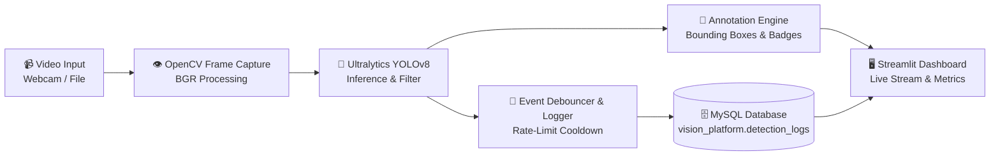

# 🎯 Real-Time Object Detection & Logging Platform

[](https://www.python.org/)
[](https://opencv.org/)
[](https://github.com/ultralytics/ultralytics)
[](https://www.mysql.com/)
[](https://streamlit.io/)

A complete computer vision and data engineering platform that performs **real-time object detection** using **Ultralytics YOLOv8** and **OpenCV**, streams live annotated video feeds through a modern **Streamlit UI dashboard**, and dynamically logs detection events to a **MySQL database** with configurable object filters and confidence thresholds.

Developed for **Assignment 5: Real-Time Object Detection & Logging Platform**.

---

## 📑 Table of Contents
- [Architecture & Workflow](#-architecture--workflow)
- [Key Features](#-key-features)
- [Repository Structure](#-repository-structure)
- [Database Schema](#-database-schema)
- [Prerequisites](#-prerequisites)
- [Installation & Quick Start](#-installation--quick-start)
- [MySQL Database Setup](#-mysql-database-setup)
- [How to Run](#-how-to-run)
  - [1. Streamlit Web Dashboard (Recommended)](#1-streamlit-web-dashboard-recommended)
  - [2. OpenCV Desktop GUI Mode](#2-opencv-desktop-gui-mode)
  - [3. Automated Self-Test](#3-automated-self-test)
- [Demonstration & Submission Links](#-demonstration--submission-links)
- [License](#-license)

---

## 🏗 Architecture & Workflow



The application strictly follows a **modular architecture**:
- `main.py`: Entry point and runtime launcher (UI, Desktop OpenCV, DB Initialization, Self-test).
- `detector.py`: YOLOv8 object detection, bounding box coordinate calculation, and class filtering.
- `database.py`: MySQL connection handling, schema creation, batch inserts, and log retrieval.
- `ui.py`: Interactive Streamlit dashboard with real-time video feed, metric cards, and log tables.
- `database_schema.sql`: DDL definitions for the `vision_platform` database and `detection_logs` table.

---

## ✨ Key Features

1. **Real-Time YOLOv8 Object Detection**
   - High-throughput inference utilizing the lightweight `yolov8n.pt` pre-trained model.
   - Extracts object class names, confidence scores, and `(x, y, w, h)` bounding box coordinates.
   - High-contrast, dynamic color-coded bounding boxes and badges rendered with OpenCV.

2. **Dynamic Class Filtering & Confidence Thresholds**
   - Interactive multiselect filter to track specific objects (e.g. `person`, `cell phone`, `laptop`, `bottle`, etc.).
   - Adjustable confidence slider (e.g. only detect/log objects with `> 70%` confidence).

3. **MySQL Event Logging**
   - Every valid detection event is logged directly to MySQL table `detection_logs`.
   - Includes intelligent rate-limiting (debounce cooldown) to prevent database flood while keeping complete historical event logs.
   - Built-in resilient fallback for offline testing if MySQL service is temporarily paused.

4. **Rich Streamlit Dashboard**
   - Live annotated video feed streaming at high FPS.
   - KPI metric cards: Processing FPS, Objects in Current Frame, Total Stored Logs, and Average Confidence.
   - Real-time detection distribution bar charts.
   - Interactive database logs table with sorting, class filtering, and one-click refresh/clear.

5. **Security Best Practices**
   - Database credentials managed via `.env` environment variables.
   - Sensitive files ignored using `.gitignore` (prevents credentials leaking to GitHub).

---

## 📁 Repository Structure

```text
├── .env.example            # Environment variables template
├── .gitignore              # Ignores .env, cache files, weights, and temporary databases
├── database.py             # Modular MySQL connection, logging, and retrieval
├── database_schema.sql     # SQL DDL script for vision_platform and detection_logs
├── detector.py             # YOLOv8 inference, coordinate extraction, and drawing
├── main.py                 # Application launcher & CLI options
├── requirements.txt        # Python dependency manifest
├── ui.py                   # Streamlit dashboard interface
├── MEDIUM_ARTICLE.md       # Complete draft for Medium publication
└── README.md               # Project documentation
```

---

## 🗄 Database Schema

The platform logs detection records into the `vision_platform` database:

```sql
CREATE DATABASE IF NOT EXISTS vision_platform;
USE vision_platform;

CREATE TABLE IF NOT EXISTS detection_logs (
    log_id INT AUTO_INCREMENT PRIMARY KEY,
    timestamp DATETIME NOT NULL DEFAULT CURRENT_TIMESTAMP,
    object_class VARCHAR(50) NOT NULL,
    confidence FLOAT NOT NULL,
    bbox_x INT NOT NULL,
    bbox_y INT NOT NULL,
    bbox_w INT NOT NULL,
    bbox_h INT NOT NULL,
    INDEX idx_timestamp (timestamp),
    INDEX idx_object_class (object_class)
);
```

### Schema Field Reference
| Column | Type | Description |
| :--- | :--- | :--- |
| `log_id` | `INT` (PK, Auto-Increment) | Unique event identifier |
| `timestamp` | `DATETIME` | Timestamp when the object was detected |
| `object_class` | `VARCHAR(50)` | Name of the detected object (e.g. `person`, `cell phone`) |
| `confidence` | `FLOAT` | Detection confidence score (0.00 – 1.00) |
| `bbox_x` | `INT` | Bounding box top-left X coordinate |
| `bbox_y` | `INT` | Bounding box top-left Y coordinate |
| `bbox_w` | `INT` | Bounding box width |
| `bbox_h` | `INT` | Bounding box height |

---

## 📦 Prerequisites

- Python 3.10+ (macOS / Windows / Linux)
- MySQL Server (via XAMPP, MySQL Workbench, or Homebrew/Docker)
- Working Webcam or test video file

---

## 🚀 Installation & Quick Start

### 1. Clone the Repository
```bash
git clone https://github.com/pratikbhor615-ops/object-detection-system.git
cd Real-Time-Object-Detection
```

### 2. Set Up a Virtual Environment
```bash
# macOS/Linux
python3 -m venv venv
source venv/bin/activate

# Windows
python -m venv venv
venv\Scripts\activate
```

### 3. Install Dependencies
```bash
pip install -r requirements.txt
```

### 4. Configure Environment Variables
Copy `.env.example` to `.env`:
```bash
cp .env.example .env
```
Edit `.env` with your MySQL server credentials:
```env
DB_HOST=localhost
DB_PORT=3306
DB_USER=root
DB_PASSWORD=your_mysql_password
DB_NAME=vision_platform
```

---

## 🛢 MySQL Database Setup

You can set up the database using any of the following methods:

### Method A: Automated CLI Initialization (Easiest)
Run:
```bash
python main.py --init-db
```
This automatically connects to your MySQL server and creates both the `vision_platform` database and `detection_logs` table.

### Method B: MySQL Workbench / XAMPP phpMyAdmin
1. Open MySQL Workbench or phpMyAdmin (`http://localhost/phpmyadmin`).
2. Open and execute [`database_schema.sql`](file:///Users/pratikbhor/Desktop/Pratik%20cep%205%20aasinment/database_schema.sql).
3. Verify the `detection_logs` table has been created under `vision_platform`.

---

## 💻 How to Run

### 1. Streamlit Web Dashboard (Recommended)
Launch the interactive web UI:
```bash
python main.py
# OR directly via Streamlit:
streamlit run ui.py
```
- Open `http://localhost:8501` in your browser.
- Configure confidence threshold and class filters on the sidebar.
- Click **▶️ Start Camera / Video** to begin real-time detection and live MySQL logging!

### 2. OpenCV Desktop GUI Mode
Run the detection pipeline in a lightweight desktop OpenCV window:
```bash
python main.py --opencv
```
- **Keybindings**:
  - `q` : Quit application
  - `s` : Save high-resolution screenshot
  - `l` : Print recent MySQL logs in console
  - `+` / `-` : Dynamically adjust confidence threshold

### 3. Automated Self-Test
Verify all modules (YOLO inference, MySQL connectivity, and log insertion) without starting the camera:
```bash
python main.py --test
```

---

## 🎥 Demonstration & Submission Links

- **GitHub Repository**: `https://github.com/pratikbhor615-ops/object-detection-system`
- **Demo Video (YouTube / Google Drive)**: `https://youtu.be/YOUR_DEMO_VIDEO`
- **Medium Article**: `https://medium.com/@YOUR_HANDLE/building-a-real-time-object-detection-and-logging-platform-with-yolo-opencv-and-mysql`
- **Submission Form**: [Google Form](https://forms.gle/fUgKta3BSytbpGpv7)

---

## 📄 License
This project is open-source under the MIT License.
